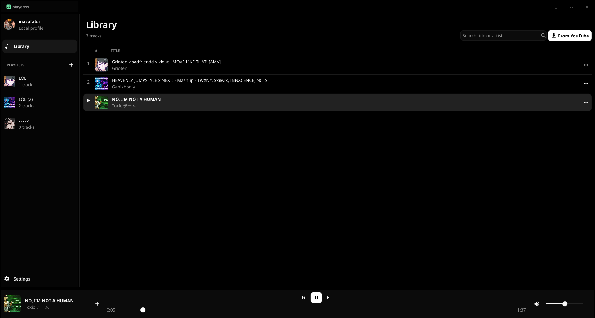

# playerzzz

**[English](#english) · [Русский](#русский)**

---



## English

A desktop music player written in Go with [Fyne](https://fyne.io): your local mp3 library, playlists with covers, a built-in YouTube audio downloader written in pure Go, and playlist sharing between users.

### Features

- **Library** — scans a folder (including subfolders) for mp3 files, reads title, artist and cover art from ID3 tags, search by title or artist.
- **Playback** — play/pause, previous/next, seeking, volume, queue built from the current library or playlist view.
- **Playlists** — create, rename, delete, add tracks from the library or right inside a playlist, custom playlist covers (or an automatic 2×2 mosaic of track covers).
- **YouTube download** — paste a link to a video up to 5 minutes long; the player downloads the audio track, converts it to mp3 and embeds the video thumbnail as cover art, plus title and channel name as tags.
- **Playlist sharing**
  - *Code* — a short text code (`pzz1:…`) with track titles and YouTube IDs; the receiver's player finds tracks in their library and downloads the rest from YouTube.
  - *File* — a single `.pzz` file with all tracks inside; works for any music, not only YouTube.
- **Safe deletion** — deleting a track moves it to the Windows Recycle Bin and removes it from every playlist.
- **Profile** — local nickname and avatar.
- **Themes** — Dark, Black, White, Neon.
- **Languages** — English (default) and Russian, switchable at runtime.
- **Custom window frame on Windows** — a title bar styled like the rest of the app, with native snapping, shadows and resizing kept intact.

### Pure Go

All of the player's own logic is pure Go, without cgo:

- WebM/Matroska demuxer — written from scratch (`internal/webm`);
- Opus decoding — [tphakala/go-opus](https://github.com/tphakala/go-opus);
- MP3 encoding — [braheezy/shine-mp3](https://github.com/braheezy/shine-mp3);
- ID3v2 tags reading and writing — written from scratch (`internal/id3`);
- YouTube client — [kkdai/youtube](https://github.com/kkdai/youtube);
- Windows API calls (custom window frame, Recycle Bin) — through `syscall`.

The only part that requires cgo is the GUI toolkit itself: Fyne draws with OpenGL through GLFW, so building needs a C compiler.

### YouTube download pipeline

```
link → kkdai/youtube (metadata + Opus audio stream)
     → internal/webm      (WebM demuxer, packets straight from the network stream)
     → go-opus            (Opus → PCM 48 kHz)
     → shine-mp3          (PCM → MP3)
     → internal/id3       (title, channel, thumbnail as cover)
```

Every stage runs in its own goroutine connected by channels, so the mp3 is encoded while the audio is still downloading. If YouTube blocks the pure-Go client (HTTP 403), the player tries several client profiles and, if [yt-dlp](https://github.com/yt-dlp/yt-dlp) and ffmpeg are installed, falls back to them.

### Requirements

- Go **1.27** or newer
- A C compiler for Fyne:
  - **Windows:** [MSYS2](https://www.msys2.org) → `pacman -S mingw-w64-ucrt-x86_64-gcc`, then add `C:\msys64\ucrt64\bin` to `PATH`
  - **Linux (Debian/Ubuntu):** `sudo apt install gcc libgl1-mesa-dev xorg-dev libasound2-dev`
- Optional: `yt-dlp` and `ffmpeg` in `PATH` as a fallback for YouTube downloads

### Run

```bash
git clone https://github.com/zeroqual/playerzzz.git
cd playerzzz
go mod download
go run ./cmd
```

### Tests

```bash
go test ./...
go test -race ./...
```

### Build

```bash
# Windows, without a console window
go build -ldflags "-H windowsgui" -o playerzzz.exe ./cmd

# Or a packaged app with the icon from Icon.png
go install fyne.io/tools/cmd/fyne@latest
fyne package -os windows
```

### Project structure

```
cmd/                 entry point
internal/
  audio/             mp3 playback (beep)
  config/            settings, profile, playlists (JSON, atomic writes)
  fsutil/            safe file names
  i18n/              English and Russian strings
  id3/               ID3v2 tags: title, artist, cover, source URL
  library/           folder scanning
  share/             playlist codes and .pzz files
  transcode/         Opus (WebM) → MP3 pipeline
  trash/             Recycle Bin on Windows, regular delete elsewhere
  ui/                Fyne interface
  webm/              streaming WebM/Matroska demuxer
  winframe/          custom window frame on Windows (WinAPI)
  youtube/           YouTube download with yt-dlp fallback
```

### Data location

Settings, playlists, the avatar and playlist covers are stored in the user config folder:

- Windows: `%APPDATA%\playerzzz`
- Linux: `~/.config/playerzzz`

### `.pzz` format

A regular zip archive:

```
manifest.json      playlist name and track list (title, artist, YouTube ID, file)
cover.png          playlist cover (optional)
tracks/001.mp3 …   the tracks (stored without compression — mp3 is already compressed)
```

### Disclaimer

Downloading videos may be restricted by YouTube's Terms of Service. Use the downloader only for content you have the right to download, for personal use, and respect copyright.

---

## Русский

Десктопный музыкальный плеер на Go и [Fyne](https://fyne.io): локальная медиатека mp3, плейлисты с обложками, встроенная загрузка звука с YouTube на чистом Go и обмен плейлистами между пользователями.

### Возможности

- **Медиатека** — находит mp3 в папке (включая вложенные), читает название, исполнителя и обложку из тегов ID3, поиск по названию и исполнителю.
- **Воспроизведение** — пауза, предыдущий/следующий трек, перемотка, громкость; очередь строится из текущего экрана — медиатеки или плейлиста.
- **Плейлисты** — создание, переименование, удаление, добавление треков из медиатеки или прямо в плейлисте, своя обложка (или автоматическая мозаика 2×2 из обложек треков).
- **Загрузка с YouTube** — вставляете ссылку на ролик до 5 минут; плеер скачивает звук, перегоняет в mp3 и встраивает превью ролика как обложку, а название и канал — в теги.
- **Обмен плейлистами**
  - *Код* — короткая строка (`pzz1:…`) с названиями треков и ID роликов; плеер получателя находит треки в его медиатеке, а недостающие докачивает с YouTube.
  - *Файл* — один файл `.pzz` со всеми треками внутри; подходит для любой музыки, не только с YouTube.
- **Безопасное удаление** — трек уходит в Корзину Windows и пропадает из всех плейлистов.
- **Профиль** — локальные ник и аватарка.
- **Темы** — Dark, Black, White, Neon.
- **Языки** — английский (по умолчанию) и русский, переключаются на лету.
- **Своя рамка окна в Windows** — заголовок в стиле приложения; привязка к краям экрана, тень и изменение размера работают как у обычных окон.

### Чистый Go

Вся логика плеера написана на чистом Go, без cgo:

- демультиплексор WebM/Matroska — свой (`internal/webm`);
- декодирование Opus — [tphakala/go-opus](https://github.com/tphakala/go-opus);
- кодирование MP3 — [braheezy/shine-mp3](https://github.com/braheezy/shine-mp3);
- чтение и запись тегов ID3v2 — своё (`internal/id3`);
- клиент YouTube — [kkdai/youtube](https://github.com/kkdai/youtube);
- вызовы WinAPI (рамка окна, Корзина) — через `syscall`.

cgo нужен только самой графической библиотеке: Fyne рисует через OpenGL и GLFW, поэтому для сборки нужен компилятор C.

### Как работает загрузка с YouTube

```
ссылка → kkdai/youtube (метаданные + поток звука Opus)
       → internal/webm      (разбор WebM прямо из сетевого потока)
       → go-opus            (Opus → PCM 48 кГц)
       → shine-mp3          (PCM → MP3)
       → internal/id3       (название, канал, превью как обложка)
```

Каждая стадия — отдельная горутина, стадии связаны каналами, поэтому mp3 кодируется, пока звук ещё скачивается. Если YouTube блокирует Go-клиент (HTTP 403), плеер пробует несколько профилей клиента, а если установлены [yt-dlp](https://github.com/yt-dlp/yt-dlp) и ffmpeg — переключается на них.

### Что нужно

- Go **1.27** или новее
- Компилятор C для Fyne:
  - **Windows:** [MSYS2](https://www.msys2.org) → `pacman -S mingw-w64-ucrt-x86_64-gcc`, затем добавить `C:\msys64\ucrt64\bin` в `PATH`
  - **Linux (Debian/Ubuntu):** `sudo apt install gcc libgl1-mesa-dev xorg-dev libasound2-dev`
- Необязательно: `yt-dlp` и `ffmpeg` в `PATH` как запасной путь загрузки с YouTube

### Запуск

```bash
git clone https://github.com/zeroqual/playerzzz.git
cd playerzzz
go mod download
go run ./cmd
```

### Тесты

```bash
go test ./...
go test -race ./...
```

### Сборка

```bash
# Windows, без окна консоли
go build -ldflags "-H windowsgui" -o playerzzz.exe ./cmd

# Или упакованное приложение с иконкой из Icon.png
go install fyne.io/tools/cmd/fyne@latest
fyne package -os windows
```

### Структура проекта

```
cmd/                 точка входа
internal/
  audio/             воспроизведение mp3 (beep)
  config/            настройки, профиль, плейлисты (JSON, атомарная запись)
  fsutil/            безопасные имена файлов
  i18n/              строки на английском и русском
  id3/               теги ID3v2: название, исполнитель, обложка, источник
  library/           сканирование папки
  share/             коды плейлистов и файлы .pzz
  transcode/         конвейер Opus (WebM) → MP3
  trash/             Корзина в Windows, обычное удаление на других системах
  ui/                интерфейс на Fyne
  webm/              потоковый разбор WebM/Matroska
  winframe/          своя рамка окна в Windows (WinAPI)
  youtube/           загрузка с YouTube с запасным yt-dlp
```

### Где хранятся данные

Настройки, плейлисты, аватарка и обложки плейлистов лежат в папке настроек пользователя:

- Windows: `%APPDATA%\playerzzz`
- Linux: `~/.config/playerzzz`

### Формат `.pzz`

Обычный zip-архив:

```
manifest.json      название плейлиста и список треков (название, исполнитель, ID ролика, файл)
cover.png          обложка плейлиста (если есть)
tracks/001.mp3 …   сами треки (без сжатия — mp3 уже сжат)
```

### Важно

Правила YouTube могут ограничивать скачивание роликов. Скачивайте только то, на что у вас есть право, для личного использования, и уважайте авторские права.
